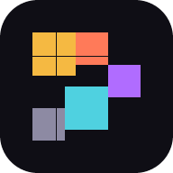

# Pixelarium - Releasing soon

**Every pixel has a story.**

Pixelarium is a  pixel-art studio for drawing, animating and exporting sprites usable as a normal website **or installed as a standalone app**. The rendering engine, GIF encoder, palette mathematics and procedural generators are original project code running in the browser; no account, server or network connection is required to create.



## Two ways to open it

| | Browser | Installed app |
| --- | --- | --- |
| How | Open the site URL (or `http://localhost:5173`) | Install from the browser once |
| Window | A tab | Its own window, dock / start-menu icon |
| Storage | IndexedDB for that origin | Same IndexedDB as the browser version of that origin |
| Offline | Works after the first load caches the app shell | Works offline by default |

Install instructions:

- **Chrome / Edge (desktop):** click the install icon in the address bar, or menu → *Install Pixelarium*. The editor also shows an **Install** button when the browser offers the prompt.
- **Safari (macOS):** *Share → Add to Dock*.
- **iOS / Android:** *Share → Add to Home Screen*.
- **Settings → App** shows installation status and whether the shell is available offline.

The installed app is the same bundle: no separate build, no separate data store, and uninstalling does not delete projects until the site data is cleared. Different origins (development `localhost:5173` vs a deployed URL) have separate browser storage — move work with `.pxl` export/import.

## Run it

Requirements: Node.js 20.19+ (tested on Node 22).

```bash
npm install
npm run dev          # http://localhost:5173
```

Production build and local check of the installable bundle:

```bash
npm run build
npm run preview      # http://localhost:4173 — manifest + service worker active
```

Other scripts:

```bash
npm run typecheck    # TypeScript project build
npm run lint         # ESLint
npm run test         # Vitest
npm run icons        # regenerate PWA icons from the mark (Node, no image deps)
```

## What is implemented

### Editor
- Real canvas engine on 2D contexts, independent of React, with dirty-rectangle repainting and no re-render per pointer move.
- Tools: pencil, pixel-perfect pencil, eraser, line, rectangle (outline/filled), ellipse (outline/filled), flood fill with tolerance, dither, spray, gradient, text (5×7 bitmap font), eyedropper, rectangular and freehand selection, move.
- Brush size 1–32, square/round tips, opacity, primary/secondary colors, right-drag secondary color, shift constraints, symmetry (X/Y/both).
- Pen pressure can drive size and/or opacity; eraser-tip pens erase without changing the selected tool.
- Custom brushes: eight built-in footprints (diagonal, cross, star, diamond, horizontal/vertical, sparkle, checker) plus any selection saved as a brush, stored in the browser.
- Tile mode wraps freehand strokes across canvas edges for seamless tiles, with a live 3×3 tiled preview.
- Selection masking that clips every drawing tool, copy/paste/delete, floating move with mask support.
- Undo/redo built on dirty-rect pixel patches for strokes and structure snapshots for layer/frame/canvas operations — not full-canvas snapshots per stroke.

### Sharing and sessions
- **Self-contained share links**: File → *Copy share link* packs the whole project (gzip + base64url) into the URL. No server, no account, no upload; opening the link imports a copy into the reader's library. A 32×32, four-frame sprite produces a ~3 KB link. Oversized projects are refused in favour of `.pxl` export instead of silently truncating.
- **Multiple sessions**: every library card and File → *Open in new tab* opens that project in its own browser tab (`?project=<id>`). Tabs keep independent in-memory documents and save per project, so two tabs on different projects never overwrite each other. The same project in two tabs is last-save-wins; the URL parameter is stripped after boot.
- **Phones**: the editor fits the canvas to the full width, wraps the top bar so Save/Export stay reachable, and turns colour, layers, the timeline and tool options into a bottom sheet. Pinch-to-zoom and two-finger pan work on touch screens.
- Keyboard-first editing: single-key tools (plus Shift variants for filled shapes, gradient and onion skin), Ctrl-based save/export/selection, frame add/duplicate/delete/reorder and layer selection/visibility shortcuts, with a press-`?` reference.

### Layers and animation
- Per-frame cels per layer, unlimited practical layers, visibility, lock, opacity, rename, reorder, duplicate, delete, merge down, blend modes.
- Timeline with add/duplicate/delete/reorder/copy/paste frames, per-frame durations, frame labels, tags, forward/reverse/ping-pong playback, looping and FPS.
- Onion skinning with configurable count, tint colors and opacity; animation preview panel; sprite-sheet layout controls.
- Undo-safe canvas resize, crop to selection, rotate 90° and horizontal/vertical flip.

### Color
- HSV field + hue slider, hex/RGB/HSL readouts, recent colors.
- Nine curated palettes (Midnight Arcade, Forgotten Kingdom, Neon Dreams, Autumn Memory, Ocean Depths, Retro Hardware, Monochrome Stories, Frostbound, Ember Forge), palette import (`.hex`, JASC-PAL, GIMP `.gpl`), export, sort, extraction with median-cut quantization, snap-to-palette and exact color replacement.
- **Indexed color mode**: picked colors snap to the active palette, stamps stay fully opaque (no blended off-palette colors), and *Remap all* snaps every layer of every frame to the palette in one undoable step.

### Creative tools
- Procedural generator (terrain, mountains, clouds, trees, rocks, water, grass, stars, crystals, patterns) with seeds and parameters; output is an editable layer.
- Dither studio (Bayer and Floyd–Steinberg) against project or extracted palettes, with preview.
- Effects: outline, drop shadow, glow, tint, hue shift, brightness/contrast, noise, quantize, pixelate, mirror.
- Palette DNA analysis and a deterministic Pixel Perfect Assistant (isolated pixels, outline issues, palette drift, color usage, symmetry preview).
- **Nine-slice preview** with per-edge inset sliders, live stretched rendering, saved guides drawn on the canvas and PNG download — for UI panels, buttons and frames.
- Tileset studio: tileset generation, tile painting, map resize, and a three-file export — map PNG, tileset PNG and a Tiled map (`.json`/`.tmj`) that opens in Tiled.

### Workspaces
- Eight workspaces share one engine and one project: the **Studios** hub starts each from a real template, and a project moves between them without leaving `.pxl`.
- **Minecraft GUI Studio** paints the menu texture itself: eight material themes (oak, market, arcane, nether, frost, emerald, classic, obsidian) with a title ribbon drawn in the project's bitmap font, recessed slot wells, bevels, corner plates, grain, accent colour and adjustable frame. Export the GUI PNG for a resource pack or plugin, bake it into a pixel project to hand-paint icons and artwork, then fill the slots and export DeluxeMenus, ItemsAdder, Oraxen and slot-map JSON.
- **Scene & Composition** stages sprites (frame, position, whole-number scale, flip, opacity, paint order) on dithered backdrops with a key light and vignette, then exports one PNG at 1×/2×/4×; the scene is saved in the project file.
- **Game Asset**, **Animation**, **Tileset & World**, **Icon & Asset Pack**, **Palette Library** and **Digital Creator** cover sprite sheets with manifests, the frame timeline, tilemaps, icon state packs, palette extraction and platform-sized avatars, emotes and stickers.
- The Studios hub ends with a **"What you can make"** gallery: three examples per workspace, all rendered by the same engines the workspaces export from, and each card opens its template or workspace.

### Cinematic camera and video
- Camera keyframes on animation frames with smooth interpolation across the frames between keys, per-scene aspect (16:9, 9:16, 1:1, 4:3, source), contain/cover fitting and background color.
- Real-time video recording of the camera view via MediaRecorder at 480p/720p/1080p and 12–60 fps (WebM where supported, MP4 in capable browsers), honoring per-frame durations; keys and scene settings persist in `.pxl`.

### Projects and export
- IndexedDB library with thumbnails, rename, duplicate, delete, autosave (debounced), recovery draft for interrupted sessions.
- Multi-tab sessions: any saved project opens in its own browser tab (`?project=<id>` deep link), so several projects stay live at once; the same project in two tabs is last-save-wins.
- Native `.pxl` format (versioned JSON, base64 RGBA cels) preserving canvas, layers, frames, durations, palettes, tags, tilemap and metadata.
- PNG (scale, transparency, all frames), sprite sheets with configurable columns/padding/spacing plus metadata in three formats — Pixelarium's full pack manifest, **Aseprite JSON** (`frames` hash + `meta.frameTags`) and **TexturePacker JSON** (array frames + `animations`) for Phaser and other atlas loaders — animated GIF via an in-house GIF89a/LZW encoder, camera-view video, PNG/JPEG import, `.pxl` import.


### Platform
- Installable web app: manifest, maskable icons, Apple touch icon, Open Graph tags, service worker with app-shell precache and offline navigation fallback.
- Browser-only, honest boundaries: cloud accounts, a hosted gallery, likes, comments, collections, challenges and remix publishing are **not shipped**. No fake community data exists anywhere in the app. Share links are self-contained URLs, not hosted pages.

## Project format

The `.pxl` schema is documented in [docs/PROJECT_FORMAT.md](docs/PROJECT_FORMAT.md).

## Tests

```bash
npm run test
```


## Architecture

```
src/
  engine/       framework-free graphics: pixel, draw, composite, history,
                palettes, quantize, gif, procedural, effects, analyze,
                serialize, tilemap, font, document
  store/        Zustand stores: project (document, history, autosave) and ui
  editor/       editor workspace: canvas stage, tools, panels, timeline, export
  components/   shared UI: icons, modal, controls, dialogs, pixel canvas
  screens/      library, palettes, playground, tileset, showcase, settings, manual
  db/           IndexedDB project library and recovery draft
  data/         generated art direction: heroScene.json, openingScene.json
  lib/          install prompt, service-worker registration, intro flag
public/         manifest, service worker, generated icons
scripts/        reproducible PWA icon generator (pure Node)
tools/scene-forge/  Java build tool that generates the hero and opening scenes
```


## PWA assets

- `public/manifest.webmanifest` — standalone display, maskable icon, theme colors.
- `public/sw.js` — cache-first hashed assets, network-first navigation with cached shell fallback; precaches the build assets listed in `index.html` at install.
- `public/icons/*` and `public/og-cover.png` — generated by `npm run icons` from the same pixel mark used in the UI.
- Registration is production-only (`src/lib/pwa.ts`), so development HMR is never cached.

## Status and known gaps and Roadmap

This repository is a working front-end studio, not a full platform. Not implemented:

- Java 21 / Spring Boot backend, PostgreSQL, authentication and REST API.
- Cloud sync, public gallery, profiles, likes, comments, collections, daily challenges, remix publishing, shareable hosted artwork URLs.
- Pixel Replay recording (designed but not built).
- User-remappable keyboard shortcuts; saved panel layouts.
- Multiple tilemap layers; animated GIF import (first frame only); GIF encoding runs on the main thread.
- More enhances, more clearer visions, more features will be implemented.
  

## License

MIT - see [LICENSE](LICENSE).
